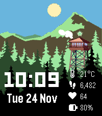
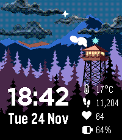
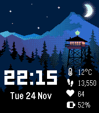
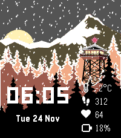
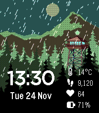

# BigFireWatch Dynamic

A fire-lookout tower in the mountains, drawn in pixel art, that follows your day: dawn, day, dusk and night, each with its own clear, partly cloudy, cloudy, rain and snow scene. A watchface for the **Pebble Time 2**.

<p>



</p>
<p>


</p>

BigFireWatch Dynamic is a fork of [FireWatch Dynamic](https://github.com/satvikmaurya/FireWatchDynamic) by satvikmaurya, with all-new scene art and a bigger tower that shows your watch's status.

## Features

- **The tower shows your watch's status.** Smoke rises while your phone is connected. The light is green when the battery is fine, red when it's low, and blinks blue while charging.
- **Weather with no API keys.** It uses the Pebble app's built-in weather: your first weather location and the provider you chose. °C/°F follows the Pebble app's units, and 12/24-hour follows the watch.
- **Settings page** (Pebble app → BigFireWatch Dynamic → Settings):
  - Type style: Classic, Digital, Digital Large (default), Rounded Large or Rounded
  - Smoke shows Bluetooth (on/off; off: the smoke always shows)
  - Light shows battery (on/off; off: the light stays red), with a low-battery level from 10% to 90%
- Steps, heart rate, battery and the date.

## Install

Download `PebbleSnrklFirewatch.pbw` from the [latest release](../../releases/latest) and open it with the Pebble app on your phone. If asked, allow Location. Weather needs a weather location set in the Pebble app.

Pebble Time 2 only for now. If you'd like it on another Pebble model, open an issue: I will build it if you agree to test it!

## Building

With the Pebble SDK (4.x) and `pebble-tool`:

```
pebble build
pebble install --emulator emery
```

## Credits and licence

- Original watchface and code: satvikmaurya, [FireWatch Dynamic](https://github.com/satvikmaurya/FireWatchDynamic). Published here with the author's permission.
- Scene art, tower overlays and changes: snrkl-labs.

All rights reserved: see [LICENSE](LICENSE). Changes are listed in [CHANGELOG.md](CHANGELOG.md).
